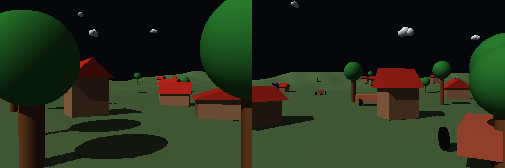

# synthetic-scene

Tiny CUDA/PyTorch synthetic scene renderer.



The renderer draws Lambert-shaded geometric objects entirely in CUDA and can
return batched RGB plus panoptic-friendly segmentation tensors. It supports up
to 64 spheres, 64 oriented boxes, 64 oriented triangular prisms, 64 oriented cylinders, and one procedural terrain per scene. Batched
renders draw different camera-space scenes.

## Build

```bash
apptainer exec --nv \
  --bind "$PWD:/workspace/synthetic-scene" \
  --pwd /workspace/synthetic-scene \
  /data/Andy/fcclip-torch27-cu126.sif \
  python setup.py build_ext --inplace
```

## Render

```bash
apptainer exec --nv \
  --bind "$PWD:/workspace/synthetic-scene" \
  --pwd /workspace/synthetic-scene \
  /data/Andy/fcclip-torch27-cu126.sif \
  python -m examples.render
```

The example writes `outputs/render.png` plus side-by-side colorized instance and
semantic label-map visualizations. Random renders include a generated rolling
procedural terrain, and grounded objects are placed on that terrain.

You can render a scene directly from Python:

```python
from synthetic_scene import Cylinders, OrientedBoxes, Prisms, RenderOptions, Scene, Spheres, Terrain, render_scene

image = render_scene(
    width=768,
    height=512,
    options=RenderOptions(shadows=True, shadow_strength=1.0, ambient=0.16),
    scene=Scene(
        spheres=Spheres(
            centers=[(-0.8, 0.0, -3.0), (0.8, 0.0, -3.2)],
            radii=[0.55, 0.65],
            colors=[(0.9, 0.25, 0.18), (0.2, 0.65, 0.95)],
        ),
        terrain=Terrain(
            base_heights=[-1.0],
            depth_limits=[7.0],
            phase_xs=[0.4],
            phase_zs=[1.2],
            dz=[0.05],
            dz_growth=[0.0001],
            colors=[(0.36, 0.46, 0.30)],
        ),
        boxes=OrientedBoxes(
            centers=[(0.0, -0.35, -2.6)],
            half_sizes=[(0.38, 0.42, 0.55)],
            axes=[
                (
                    (0.866, 0.0, -0.5),
                    (0.0, 1.0, 0.0),
                    (0.5, 0.0, 0.866),
                ),
            ],
            colors=[(0.45, 0.9, 0.48)],
        ),
        prisms=Prisms(
            centers=[(-0.95, -0.35, -2.7)],
            half_sizes=[(0.42, 0.46, 0.50)],
            axes=[
                (
                    (0.707, 0.0, -0.707),
                    (0.0, 1.0, 0.0),
                    (0.707, 0.0, 0.707),
                ),
            ],
            colors=[(0.80, 0.55, 0.95)],
        ),
        cylinders=Cylinders(
            centers=[(0.95, 0.05, -2.55)],
            radii=[0.22],
            half_heights=[0.70],
            axes=[
                (
                    (0.0, 1.0, 0.0),
                    (1.0, 0.0, 0.0),
                    (0.0, 0.0, 1.0),
                ),
            ],
            colors=[(0.95, 0.48, 0.22)],
        ),
    ),
)
```

RGB tensors are returned as `B x 3 x H x W`. Unbatched scene tensors return
`B = 1`; scene tensors shaped as `B x N x ...` render one independent scene per
batch item. Object coordinates are camera-space, with the camera at the origin
looking down `-Z`.

Directional-light hard shadows are enabled by default. Set
`RenderOptions(shadows=False)` to render direct Lambert shading without shadow
rays, or tune `shadow_strength` in `[0, 1]` to control how much blocked direct
light is removed. The default `1.0` leaves shadowed pixels at the same ambient
floor as surfaces facing away from the light. Increase `ambient` to soften both
cast shadows and unlit object sides together.

To request segmentation ground truth, pass `return_maps=True`:

```python
from synthetic_scene import render_scene, save_image, save_label_map_visualization

result = render_scene(width=768, height=512, scene=scene, return_maps=True)
save_image(result.image[0].permute(1, 2, 0), "outputs/render.png")
save_label_map_visualization(result.instance_map[0], "outputs/instance_map.png")
save_label_map_visualization(result.semantic_map[0], "outputs/semantic_map.png")
```

`instance_map` is a `B x H x W int32` tensor with `0` for background and one
sequential ID for each visible object in that image. `visible_count` is a
`B int32` tensor with the number of visible objects per image. `visible_classes`
and `visible_instance_ids` are `B x MAX_GT int32` tensors where columns
`0:visible_count[b]` contain the class labels and instance IDs for visible
objects. `MAX_GT` is the total number of objects in the scene. Class labels are
`1 = sphere`, `2 = terrain`, `3 = box`, `4 = cylinder`, `5 = prism`; unused
class slots and background pixels are `0`.

`semantic_map` is also returned as a `B x H x W int32` compatibility tensor with
primitive class labels per pixel: `0 = background`, `1 = sphere`,
`2 = terrain`, `3 = box`, `4 = cylinder`, `5 = prism`.
Raw label maps are saved as 16-bit PNGs so the numeric IDs are preserved. The
visualization helper maps each consecutive integer label to a deterministic
random RGB color, keeping background label `0` black.

Finite primitive families also accept optional `class_ids` and `instance_ids`
metadata with shape `N` or `B x N`. Terrain is scene-level and has scalar
`class_id` and `instance_id` fields instead. When custom metadata is present,
`instance_map` preserves those instance IDs instead of compacting to sequential
IDs, and `semantic_map` uses the provided classes. Composite objects can be
positioned, rotated, and flattened into raw primitives before rendering. Terrain
cannot be part of a composite object; pass it through `base_scene` if needed.

```python
from synthetic_scene import (
    CarConfig,
    HouseConfig,
    PersonConfig,
    Scene,
    Spheres,
    Terrain,
    TreeConfig,
    flatten_composite_objects,
    make_car,
    make_cloud,
    make_house,
    make_person,
    make_tree,
)

base_scene = Scene(
    spheres=Spheres(centers=(), radii=(), colors=()),
    terrain=Terrain(
        base_heights=[-1.0],
        depth_limits=[7.0],
        phase_xs=[0.4],
        phase_zs=[1.2],
        dz=[0.05],
        dz_growth=[0.0001],
        colors=[(0.36, 0.46, 0.30)],
    ),
)

scene = flatten_composite_objects([
    make_house(
        instance_id=1001,
        config=HouseConfig(width=1.4, depth=1.0, body_height=0.9, roof_height=0.45),
        position=(-1.0, -1.0, -4.0),
        rotation=((0.0, -1.0, 0.0), (1.0, 0.0, 0.0), (0.0, 0.0, 1.0)),
    ),
    make_house(
        instance_id=1002,
        config=HouseConfig(width=0.9, depth=0.8, body_height=0.65, roof_height=0.35),
        position=(0.8, -1.0, -3.4),
    ),
    make_tree(
        instance_id=2001,
        config=TreeConfig(trunk_height=0.9, trunk_radius=0.08, crown_radius=0.36),
        position=(-2.0, -1.0, -3.6),
    ),
    make_tree(
        instance_id=2002,
        config=TreeConfig(trunk_height=1.25, trunk_radius=0.12, crown_radius=0.52),
        position=(1.8, -1.0, -4.2),
    ),
    make_cloud(instance_id=3001, position=(0.5, 1.2, -5.0)),
    make_car(instance_id=4001, config=CarConfig(body_color=(0.8, 0.1, 0.08)), position=(-0.2, -1.0, -2.9)),
    make_person(instance_id=5001, config=PersonConfig(height=1.15), position=(1.1, -1.0, -3.0)),
], base_scene=base_scene)
```

## Random Scenes

For synthetic data generation, create seeded random camera-space scenes:

```python
from synthetic_scene import RandomSceneOptions, generate_random_scene, render_scene

width = 768
height = 512
scene_options = RandomSceneOptions(
    house_count=3,
    tree_count=8,
    cloud_count=2,
    car_count=2,
    person_count=4,
    aspect_ratio=width / height,
    depth_limit=7.0,
    terrain_dz=0.05,
    terrain_dz_growth=0.0001,
)
generated = generate_random_scene(seed=1234, batch_size=8, options=scene_options)
result = render_scene(
    width=width,
    height=height,
    scene=generated,
    return_maps=True,
)
```

Randomly generated scenes use a packed CUDA representation containing one
floating-point buffer, one integer buffer, and the primitive capacities needed
to interpret them. Generation and rendering exchange these buffers directly;
they do not construct nested dictionaries or intermediate `Scene` objects.

The structured API separates reusable generation options from execution:

```python
from synthetic_scene import RandomSceneOptions, generate_random_scene, render_scene

scene_options = RandomSceneOptions(house_count=12, tree_count=20)
packed_scene = generate_random_scene(1234, batch_size=8, options=scene_options)
image = render_scene(1024, 1024, scene=packed_scene)
```

When the intermediate scene is not needed, generation and rendering can be
expressed as one operation:

```python
from synthetic_scene import render_random_scene

image = render_random_scene(
    1234,
    width=1024,
    height=1024,
    batch_size=8,
    scene_options=scene_options,
)
```

Random scenes always include a generated procedural terrain and random
composite objects. `house_count`, `tree_count`, `cloud_count`, `car_count`, and
`person_count` create randomized houses, trees, clouds, cars, and people with
per-object instance IDs and semantic classes `10` through `14`. Ground objects
are placed with camera-frustum sampling and grounded against the generated
terrain height; clouds are sampled in the upper frustum.
The native random scene generator expands composite templates directly into
the packed buffers consumed by the renderer.
Objects within each scene are generated in parallel into disjoint primitive
slots. Each object advances directly to its portion of the seeded random stream,
preserving the serial generator's random draws and object ordering (floating-point
rounding can differ). Changes to a template's
random draws must also update its draw count in the CUDA dispatcher.

## Benchmark

```bash
apptainer exec --nv \
  --bind "$PWD:/workspace/synthetic-scene" \
  --pwd /workspace/synthetic-scene \
  /data/Andy/fcclip-torch27-cu126.sif \
  python -m examples.benchmark
```

The benchmark generates and renders the same seeded random scene style as
`examples.render`, with a batch size of 8 by default. Each measured iteration
generates a new deterministic scene and requests RGB, instance and semantic
maps, and visible-instance metadata. You can sweep the image size, batch size,
sample count, profiler sample count, and random seed:

```bash
apptainer exec --nv \
  --bind "$PWD:/workspace/synthetic-scene" \
  --pwd /workspace/synthetic-scene \
  /data/Andy/fcclip-torch27-cu126.sif \
  python -m examples.benchmark --width 1920 --height 1080 --cameras 16 --iterations 200 --seed 5678
```

Pass `--no-shadows` to measure the pipeline with shadow rays disabled, or
`--no-terrain` to render generated scenes without their procedural terrain:

The benchmark uses an unprofiled pass for end-to-end CUDA event and synchronized
host wall timing. A separate profiler pass attributes GPU execution to random
scene generation, renderer input preparation, terrain rasterization, cluster-mask
construction, rendering, and segmentation. Input preparation includes device
conversion, batch broadcasting, validation, metadata construction, and output
allocation. Time in the profiled interval that is not owned by one of those
ranges is reported as `unattributed / profiler overhead`; it includes submission
gaps and instrumentation overhead. Because profiling can slow workloads with
many small tensor operations, compare the stage rows with the displayed profiled
total, not with the unprofiled end-to-end result. The benchmark also reports the
combined output tensor size and PyTorch CUDA allocated/reserved memory peaks.

## Amodal masks and occlusion ground truth

```python
from synthetic_scene import render_scene, save_amodal_visualization

annotated = render_scene(768, 512, scene=generated, return_occlusion=True)
# RGB, instance_map, semantic_map, panoptic_map, and amodal share one result.
save_amodal_visualization(annotated, "outputs/amodal.png")
amodal = annotated.amodal[0]  # first batch item
```

`return_occlusion=True` also enables label maps and returns per-image annotations
on `RenderResult.amodal`. With this flag off, `amodal` is None.
`panoptic_map` has shape B x H x W x 2, with (semantic class, instance ID)
in its last dimension.
This optional path supports structured and packed random scenes. A CUDA coverage
pass reuses the normal render’s spatial candidate masks and terrain depth, testing
all relevant primitives without stopping at foreground hits. Parts sharing an
instance ID contribute to one amodal mask. Terrain is also an annotated instance
and its coverage counts as occlusion of other instances. Custom
instance IDs must be positive, with one class per instance ID; default structured
scenes receive stable IDs before rendering.

Each batch item has `instance_ids` and `class_ids` of length N, containing only
instances with at least one visible camera pixel. Fully hidden and offscreen
instances are excluded before allocating masks or testing amodal intersections;
cast shadows do not qualify an instance as visible. For a retained composite,
all its parts contribute, including parts with no visible pixels of their own.
`amodal_masks` and `visible_masks` are boolean N x H x W tensors.
`occlusion_fraction` is hidden pixel area divided by amodal area.
`occlusion_matrix` is a boolean N x N tensor: `[i, j]` is true if instance
`instance_ids[i]` is the frontmost covering object at any hidden pixel of
`instance_ids[j]`. Rows are occluders and columns are occluded targets. Both axes
use the same instance ordering as the masks; the diagonal is false. Relationships
are camera-specific and can point in both directions for different object parts.
The matrix does not infer indirect edges or include fully hidden instances.

This replaces the previous dense hidden masks and per-pixel occluder-ID maps.
If needed, a hidden mask is recoverable as `amodal_masks & ~visible_masks`.

```python
amodal = annotated.amodal[0]
# Does the first listed instance cover any part of the second?
first_occludes_second = amodal.occlusion_matrix[0, 1]
```

Coverage uses the renderer's pixel samples and geometry, within the image frame;
it does not measure offscreen truncation or hidden 3D surface area. Self overlap
within an instance and cast shadows do not count as external occlusion.
CUDA kernels group instance metadata, union primitive silhouettes, compute visible
masks and pairwise occlusion links, and reduce pixel counts to occlusion
fractions. The normal visible-instance outputs reuse this metadata instead of
running a second instance-compaction pass. Candidate masks are shared per image
tile; known visible intersections and already-covered composite parts are skipped.
A fused annotation kernel keeps per-ray coverage in a bitset and directly writes
amodal and visible masks. Warp ballots produce per-tile area
counts and aggregate pairwise relationship bits; a final reduction emits the
boolean matrix and occlusion fractions. This avoids clearing/re-reading dense amodal
masks and a separate dense classification pass. Up to 32 visible instances use a
single coverage word; larger counts use multiple words.
Python only wraps the returned tensors; no per-instance rendering is
performed. One small count readback determines the dense output allocation size.
Mask storage requires O(B x N x H x W) GPU memory and relationships require
O(B x N²). Use smaller batches or
resolutions for large datasets.

The exporter writes a single `amodal.png`: all instance silhouettes are overlaid
on RGB with colored outlines. Overlapping masks blend equally; colors match the
instance-map visualization. Batch images appear side by side. This is a visual
preview; numeric ground truth remains available in `annotated.amodal`.

To render and export the example dataset:

```bash
conda run -n clipdino-cu117 python -m examples.render --occlusion
```

Benchmark the normal renderer with and without occlusion outputs (including scene
generation, excluding image export):

```bash
conda run -n clipdino-cu117 python -m examples.benchmark --occlusion --batch-size 2 --seed 44
```

`--occlusion` runs baseline and annotation-enabled measurements using the same
benchmark loop, scene seeds, CUDA profiler, and memory reporting. Add
`--export-amodal outputs/amodal.png` to also time PNG overlay export separately.

Measured on NVIDIA RTX 2080 SUPER at 768 x 512, batch 2, 36 generated instances
per image including terrain, shadows enabled, seeds 44–143, 10 warmups and 100
measured iterations. Only camera-visible instances receive amodal annotations
(16 and 24 for the two images at seed 44). Synchronized host timings include
generation and exclude export:

| Outputs | Mean per batch | Median | p95 | Images/s | Peak allocated GPU memory |
| --- | ---: | ---: | ---: | ---: | ---: |
| RGB and visible maps | 1.64 ms | 1.55 ms | 2.24 ms | 1222.9 | 20.1 MiB |
| Also CUDA amodal masks and pairwise occlusion | 1.87 ms | 1.82 ms | 2.31 ms | 1070.2 | 73.4 MiB |

These timings include generation and all returned tensors, with PNG export
excluded. The pairwise representation removes dense hidden-mask and occluder-ID
outputs. Matrix construction uses CUDA warp/tile bitsets and is fused with mask
coverage; Python only wraps the returned tensors. These figures describe this
machine and scene configuration.

A small visible-count readback determines annotation allocation sizes. Outputs
contain only visible instances; no workspace API is required to use the renderer.

### Visible object parts

Pass `return_parts=True` to `render_scene` or `render_random_scene` to request
modal part ground truth (this also enables the instance and semantic maps):

```python
result = render_scene(width=768, height=512, scene=scene, return_parts=True)
# result.part_masks[b, p]: boolean H x W visible mask
# result.part_belongs_to[b, p, o]: part p belongs to visible object o
# result.visible_instance_ids[b, o]: that object's instance ID
```

Each geometric primitive is one part: for example, a person's head and separate
body/limb boxes, or a house's body and roof. Parts are distinguished even when
primitives share an object instance ID. These are primitive instances, without
semantic part categories such as “left arm”. Terrain is treated as one part.
Geometry labeled with instance ID zero is excluded.

`part_count` is an int32 CUDA tensor of shape `B`. `part_map` is an int32 CUDA
tensor of shape `B x H x W`, with zero for background and compact 1-based part
IDs. `part_masks` has shape `B x P x H x W` and `part_belongs_to` has shape
`B x P x O`, both boolean CUDA tensors. `P` is the maximum visible part count
in the batch, and `O` matches the width of `visible_instance_ids`. Rows beyond
`part_count[b]` are false; part map ID `p + 1` corresponds to mask row `p`.
Fully hidden parts are omitted, and masks exclude pixels occluded by other
parts of the same object as well as other objects. Part ordering follows
primitive slots and is not a semantic ordering.

Part hits are written during the existing CUDA rendering pass. All scenes reuse
the primitive visibility bitset and metadata for compaction, avoiding
full-image ownership scans. A fused CUDA kernel writes the compact label map and
dense masks. Another CUDA kernel compacts the small metadata table; membership
is constructed with a CUDA tensor comparison.
One aggregate count readback sizes the dense mask output. Dense
masks use `B * P * H * W` bytes, so request parts only when needed. The part
fields are `None` when `return_parts=False`.

Run `python -m examples.benchmark --compare-outputs` inside the CUDA image to compare RGB,
object maps, and parts. On an A100 80GB PCIe, an interleaved comparison of the
original tensor implementation and fused CUDA implementation gave these median
synchronized wall times for rendering with parts (milliseconds per batch):

| Resolution | Batch | Original | Fused CUDA |
| --- | ---: | ---: | ---: |
| 256 x 256 | 1 | 1.51 | 1.27 |
| 256 x 256 | 8 | 1.95 | 1.54 |
| 768 x 512 | 1 | 1.59 | 1.35 |
| 768 x 512 | 8 | 3.79 | 2.33 |

Measurements used seed 1234, default random scenes, shadows enabled, 10 warmups,
and 50 measured iterations per implementation, excluding scene generation.
Outputs matched exactly. At 768 x 512 with batch 8, peak additional allocated
memory decreased from 354 MiB to 330 MiB; dense output sizes remain unchanged.


`python -m examples.render` also writes the visible-part visualization to
[`outputs/part_map.png`](outputs/part_map.png), aligned with
[`outputs/render.png`](outputs/render.png). Each color denotes one visible part.
Use `python -m examples.benchmark --parts` to include parts in the existing
end-to-end benchmark and stage profiler; `--compare-outputs` compares all three
output modes on pre-generated scenes.


Parts and amodal annotations can be requested together:

```python
result = render_scene(768, 512, scene=generated,
                      return_parts=True, return_occlusion=True)
```

Part masks remain modal. Membership columns refer to `visible_instance_ids`;
match those IDs to each image's `amodal.instance_ids` to associate parts with
amodal object masks. The union of an object's part masks equals its visible
object mask. `python -m examples.render --occlusion` exports both visualizations.
`python -m examples.benchmark --compare-outputs --occlusion` also compares
amodal-only and combined parts/amodal output modes. The normal benchmark accepts
`--parts --occlusion` together and counts both annotation types in output memory.
